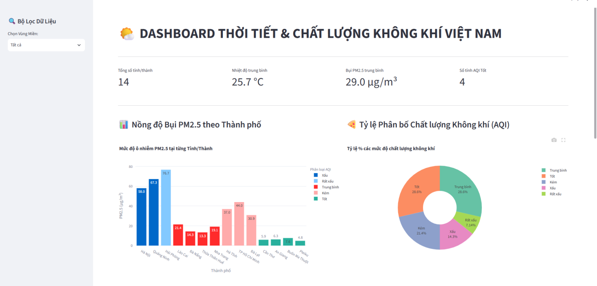
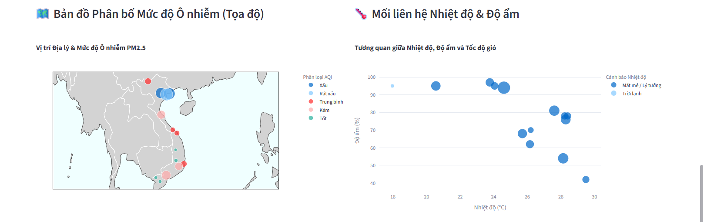

# Vietnam Weather & Air Quality Analytics

An individual Data Visualization course project by **Le Thuan Truong**, a Data Engineering student at the Posts and Telecommunications Institute of Technology (PTIT).

**Project period:** 3–18 October 2026  
**Author:** [Truong2005-rgb](https://github.com/Truong2005-rgb)

## Overview

This project combines weather and air pollution data from OpenWeatherMap to compare **14 locations across 4 regional groups**. It covers API collection, data quality checks, merging, exploratory analysis, and an interactive Streamlit dashboard.

I completed the collection scripts, data processing, exploratory analysis, dashboard, and course report individually.

## Results and scope

- Collected weather and air pollution data through **2 API endpoints**.
- Produced a **14-row, 18-column** final dataset, including 2 derived classification columns.
- The included CSV snapshot has **no missing values or duplicate locations**.
- Built **4 interactive charts**, **4 KPI cards**, a regional filter, and a detailed data table.
- Enabled side-by-side inspection of PM2.5, AQI categories, temperature, humidity, and wind speed across the selected locations.

These figures describe the implemented project and its sample data. This is a data analysis and visualization project; it does not train a forecasting or machine learning model.

## Dashboard preview





The screenshots were extracted from the original course report and show a different collection run from the bundled CSV snapshot. They illustrate the dashboard layout; the displayed measurements and category counts may differ when you run the app. The supplied CSV files are mutually consistent.

## Technology stack

- **Python** and **Requests**: API collection.
- **pandas**: missing-value checks, deduplication, merging, derived categories, and descriptive statistics.
- **Plotly Express**: bar, donut, geographic scatter, and weather scatter charts.
- **Streamlit**: interactive dashboard and region filtering.
- **python-dotenv**: local API key configuration for the GitHub-ready package.

## Data flow

```text
OpenWeatherMap Current Weather + Air Pollution APIs
                      |
           01_thu_thap_du_lieu.py
                      |
          weather_raw.csv + air_raw.csv
                      |
        02_lam_sach_va_ket_hop.py
                      |
         vietnam_weather_air_merged.csv
                      |
          03_kham_pha_va_tao_cot.py
                      |
          vietnam_weather_air_final.csv
                      |
             04_dashboard_app.py
```

The final table contains location/region identifiers, coordinates, weather measurements, AQI level, pollutant concentrations, and AQI/temperature labels.

## Run locally with the included sample data

Use Python 3.10 or later. Open a terminal **inside the project folder** so that relative CSV paths resolve correctly.

```bash
python -m venv .venv
```

Activate the environment:

**Windows PowerShell**

```powershell
.\.venv\Scripts\Activate.ps1
```

**Windows Command Prompt**

```bat
.venv\Scripts\activate.bat
```

**macOS / Linux**

```bash
source .venv/bin/activate
```

Install dependencies and open the dashboard:

```bash
python -m pip install -r requirements.txt
python -m streamlit run 04_dashboard_app.py
```

Open the local URL printed by Streamlit, usually `http://localhost:8501`. An API key is **not required** to view the bundled sample CSVs.

## Collect fresh data (optional)

1. Obtain an API key from [OpenWeatherMap](https://openweathermap.org/api) with access to Current Weather and Air Pollution.
2. Copy `.env.example` to `.env` in the project folder.
3. Replace the placeholder in `.env` with your own key:

```dotenv
OPENWEATHERMAP_API_KEY=your_openweathermap_api_key
```

4. Run the scripts in order:

```bash
python 01_thu_thap_du_lieu.py
python 02_lam_sach_va_ket_hop.py
python 03_kham_pha_va_tao_cot.py
python -m streamlit run 04_dashboard_app.py
```

Collection overwrites the raw CSV files; the next scripts regenerate the merged/final CSVs. If the dashboard is already running, clear its data cache or restart it after refreshing the files. Collection depends on API availability and your account limits.

The `.env` file is excluded by `.gitignore`. Do not upload it or paste a real API key into code, screenshots, or the README.

## Limitations

- The sample contains one observation per location, not a historical time series; the scripts do not retain API timestamps in the CSV output.
- Coordinates represent selected points, not province-wide averages or a nationally representative sample.
- Regional grouping follows the course project configuration.
- AQI labels map OpenWeatherMap's **1–5 scale**, not Vietnam's VN_AQI scale.
- Missing values are checked, but the scripts do not implement general-purpose imputation.
- Updates require rerunning the collection/processing scripts. This is not a continuously updated streaming system.
- The dashboard uses cached CSV loading and runs locally; no public deployment is included.

## Packaging changes

The course project's processing and chart logic is preserved. For this GitHub-ready package, the collection script reads the key from `.env`/environment variables, adds a 10-second request timeout, and reports the number of collected locations. Setup instructions, example environment configuration, dependency requirements, and report screenshots have been added.

## References

- [OpenWeatherMap Current Weather](https://openweathermap.org/current)
- [OpenWeatherMap Air Pollution API](https://openweathermap.org/api/air-pollution)
- [pandas documentation](https://pandas.pydata.org/docs/)
- [Plotly Python documentation](https://plotly.com/python/)
- [Streamlit documentation](https://docs.streamlit.io/)
